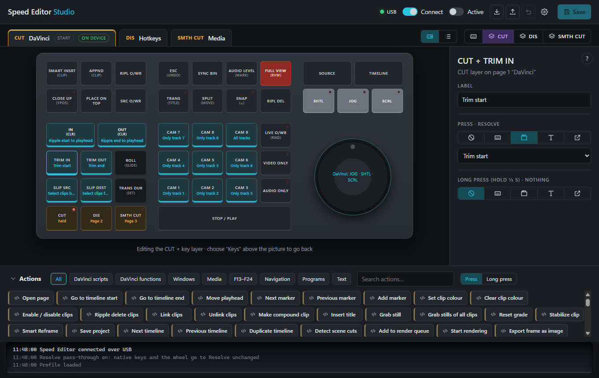
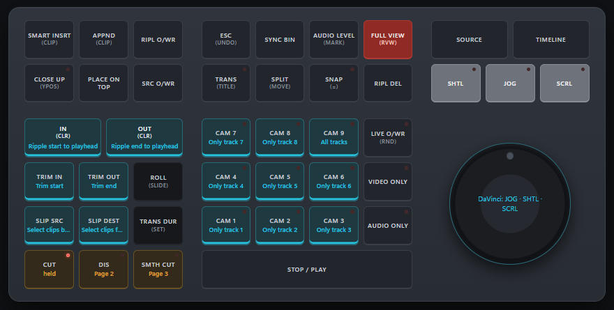

# Speed Editor Studio

Your own key bindings for the Blackmagic **DaVinci Resolve Speed Editor**, working inside DaVinci
Resolve, while every key and the jog wheel keep their native behaviour.

[](https://github.com/sponsors/koosoli)
[](https://buymeacoffee.com/koosoli)

> [!TIP]
> **Don't want to compile? A ready-to-use Windows build is waiting for you.**
> Supporters get access to our private builds repository,
> [SpeedEditorStudio-Builds](https://github.com/SpeedEditorStudio/SpeedEditorStudio-Builds/releases),
> with tested, ready-to-run releases. Become a member through
> [GitHub Sponsors](https://github.com/sponsors/koosoli) for a humble monthly contribution, or
> support the project once through [Buy Me a Coffee](https://buymeacoffee.com/koosoli) and
> leave your GitHub username, and you'll be added. Either way you directly fund the
> project's development, testing and build distribution. Building from source stays free,
> and your rights under the license are the same either way.



DaVinci Resolve opens the Speed Editor exclusively, so other tools can't add anything to it
while Resolve runs. Speed Editor Studio takes over the device instead and presents Resolve
with an **emulated Speed Editor**. Keys doing their native job and the wheel are passed
through to Resolve unchanged, so they behave exactly like the original, Smart Insert and
the jog feel included. On top of that, you add your own pages, an Fn layer and Stream
Deck-style actions, which the app handles itself. **You never have to change a shortcut in
Resolve.**

## Features

- **Native behaviour, unchanged.** With [usbip-win2](https://github.com/vadimgrn/usbip-win2)
  installed, native keys and the wheel go to Resolve through an emulated Speed Editor, so
  Resolve itself handles them, including its LEDs and wheel modes. Without usbip-win2 the app
  imitates them: a calibrated wheel and Resolve's shortcuts and menus.
- **Three pages on CUT, DIS and SMTH CUT.** CUT is the "DaVinci" page: everything native,
  with any key you choose replaced by your own action. DIS and SMTH CUT are free pages. The
  active page's LED blinks.
- **Normal mode.** CUT + SMTH CUT switches every key back to its plain native function (the
  three LEDs flash to confirm). Press the chord again to return to your pages.
- **Fn layer.** Hold CUT and press another key: each page has its own second layer.
  Examples in the default profile: ripple start/end to playhead, trim start/end, select
  clips forward/backward on all tracks.
- **Track targeting.** CUT + CAM n makes only video track n + audio track n take part in
  edits, until CUT + CAM 9 turns all tracks back on. The CAM key stays lit.
- **Move a clip frame by frame.** Hold CUT + SPLIT and turn the wheel. SPLIT + wheel on its
  own swaps clips, one clip per touch.
- **Stream Deck-style keys.** Each key gets a label, a press action and a long-press action:
  a shortcut, a Resolve function, a Resolve menu item, a Resolve script command, an app or
  URL to open, or text to type.
- **Resolve menus without shortcuts.** Functions that have no usable shortcut are run through
  Resolve's own menus (Windows UI Automation), so they work on any keyboard layout.
- **Live mirror.** The app shows the device's LEDs, flashes the keys you press, turns the
  on-screen wheel and shows the battery level.
- **USB and Bluetooth.**
- **Profiles.** Save, export and import as plain TOML. See
  [`profiles/example.toml`](profiles/example.toml).



Keys show their secondary function in brackets, as printed on the device. "DaVinci" means the
key does its native job. "—" means Resolve has no keyboard command for it, so the key is free
for your own mapping.

## Requirements

- Windows 10 or 11.
- DaVinci Resolve (developed and measured with Resolve Studio 21.1). For the script actions,
  set *Preferences › System › General › External scripting using* to **Local**.
- A DaVinci Resolve Speed Editor, over USB or paired over Bluetooth.
- Recommended: [usbip-win2](https://github.com/vadimgrn/usbip-win2/releases) (free,
  Microsoft-signed drivers) for pass-through of native keys to Resolve. No restart was needed
  after installing it.

## Build and run

You need [Rust](https://rustup.rs/) (stable) and the WebView2 runtime, which Windows 11 has
built in.

```bash
cargo build --release
```

Then start `target\release\se-studio.exe`. Turn on **Connect** and **Mappings active**.

**Start Speed Editor Studio before DaVinci Resolve.** Windows lets only one program hold the
Speed Editor, and Resolve takes one the moment it appears. When the app holds the real device
first, Resolve uses the emulated one instead.

The easiest way is **Start with Windows** (top bar): the app then starts hidden in the system
tray when you sign in. Closing the window keeps it running in the tray; **Quit** in the tray
menu ends it. If Resolve got the device first anyway, the app says so: quit Resolve and start
it again.

- **Give to Resolve** hands the device back to Resolve's own driver whenever Resolve runs.
  It's off by default, because then your mappings can't work inside Resolve.
- Your profile is saved to `%APPDATA%\OpenSpeedEditor\profile.toml`.

There is also a command-line runner without a window:

```bash
cargo run --release -p se-mapper -- profiles/example.toml
```

Setting the environment variable `OPEN_SPEED_EDITOR_LOG` to a file path makes the app log
every wheel report and every action it sends. That is useful when something doesn't reach
Resolve.

## How it works

| Part | What it does |
| --- | --- |
| [`crates/speed-editor`](crates/speed-editor) | HID protocol: authentication, keys, LEDs, jog modes, battery |
| [`crates/mapper`](crates/mapper) | Pure engine: pages, Fn layer, long press, native gestures, the Resolve-style wheel |
| [`crates/runtime`](crates/runtime) | Device loop, keyboard output, Resolve scripting helper, menus via UI Automation, focus handling, wheel pacing |
| [`apps/studio`](apps/studio) | The Tauri app (plain HTML/JS UI in `apps/studio/ui`) |
| [`apps/se-mapper`](apps/se-mapper) | Command-line runner |
| [`tools/se-probe`](tools/se-probe), [`tools/se-emu`](tools/se-emu), [`tools/capture`](tools/capture) | Protocol probe, stand-alone emulated Speed Editor, USB capture decoder and the test robots used for measuring Resolve |

Everything measured along the way is in [`docs/FINDINGS.md`](docs/FINDINGS.md), from wheel
units per frame and the shuttle curve to which key sequences give a ripple, roll or slip
trim. Decoded captures are in [`docs/captures`](docs/captures).

## Known limits

- Without usbip-win2, some Speed Editor functions have no Resolve keyboard command, so they do
  nothing until you map them: CLOSE UP, TRANS DUR, SYNC BIN, SMTH CUT (as a transition), SRC
  O/WR and others. Some shortcuts can't be typed on every keyboard layout (for example `[`, `]`
  and some Alt+F combinations on a German layout); those go through Resolve's menus.
- The emulated device doesn't yet give the real device's answer in the authentication
  handshake (the device side uses an unknown calculation). Resolve retries and then accepts it
  anyway; a future Resolve version might be stricter.
- The jog wheel's click is mechanical only. The device reports nothing, so it can't be mapped.
- Windows only for now.

## License

Copyright 2026 Olivier KOOS. Licensed under the
[PolyForm Noncommercial License 1.0.0](LICENSE).

- **Free for noncommercial use:** personal projects, hobby work, study, research, and
  charities, schools and public institutions.
- **Not for commercial use.** For commercial use, ask Olivier KOOS for a separate license.
- **Credit required:** anyone who passes on any part of the software must include the
  license terms and the `Required Notice` line from [`LICENSE`](LICENSE).

This is a source-available license, not an OSI-approved open-source license.

## Credits

Created by Olivier KOOS.

The device authentication and the key, LED and jog tables are ported from
[bmd.py](https://github.com/smunaut/blackmagic-misc/blob/master/bmd.py) by Sylvain Munaut,
under the Apache License 2.0. See [`NOTICE`](NOTICE).

*DaVinci Resolve and Speed Editor are trademarks of Blackmagic Design. This project is not
affiliated with Blackmagic Design.*
